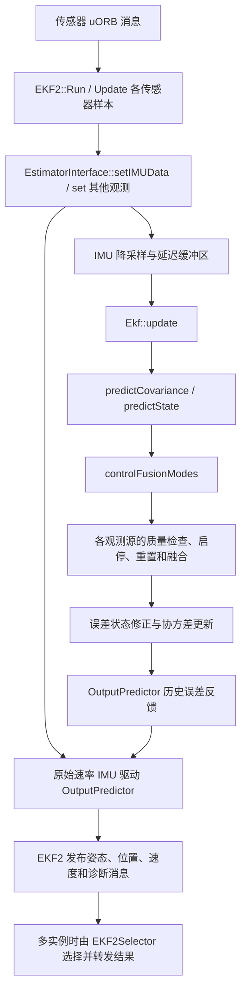

# PX4 EKF2 源码导读与学习顺序

本导读以当前工作区 `src/modules/ekf2/` 的文件为依据，包括模块封装、算法、参数、公式生成、测试和数据文件。下文链接均相对于本文件所在目录。源码会随 PX4 版本变化，函数和状态索引应以当前代码为准。

建议先读“整体运行关系”和“推荐阅读顺序”，再按“逐文件说明”查阅具体文件。学习目标是能够追踪一条观测从输入、时间对齐、创新检验到状态修正和输出的完整过程。

## 1. 整体运行关系



三个类的分工：

| 类 | 主要职责 |
| --- | --- |
| `EKF2` | PX4 模块封装：调度、uORB 收发、参数和设备变化处理、诊断发布。持有一个 `Ekf` 实例。 |
| `EstimatorInterface` | 算法输入输出接口：观测结构、缓冲区、时间补偿、IMU 降采样、输出预测器、辅助源状态查询。 |
| `Ekf : public EstimatorInterface` | EKF 算法：状态预测、协方差预测、观测融合、对准、故障处理和状态重置。 |
| `EKF2Selector` | 多实例选择：比较实例健康状况和误差，转发选中结果，并处理切换时的重置信息。 |

一个 EKF 周期的主线位于 `Ekf::update()`：

```text
读取延迟 IMU 样本
  -> 更新平均 EKF 周期、检查初始化
  -> updateIMUBiasInhibit()
  -> predictCovariance()
  -> predictState()
  -> controlFusionModes()
  -> OutputPredictor::correctOutputStates()
```

`setIMUData()` 还会在每次输入 IMU 时调用 `calculateOutputStates()`，因此输出预测器可以比主 EKF 更高频率地推进到当前时间。延迟主滤波器提供观测融合后的校正，输出预测器提供供控制器使用的低延迟状态。

## 2. 先认识当前版本的状态

直接查看 [state.h](EKF/python/ekf_derivation/generated/state.h)。默认生成配置中，状态存储有 25 个数，误差状态有 24 维，协方差为 `24 x 24`。差别来自姿态：四元数存 4 个数，小角度姿态误差只有 3 个自由度。

| 状态 | 存储维数 | 误差状态维数 | 物理意义 |
| --- | ---: | ---: | --- |
| `quat_nominal` | 4 | 3 | 机体系到导航系的姿态 |
| `vel` | 3 | 3 | NED 速度 |
| `pos` | 3 | 3 | 位置相关状态及其误差 |
| `gyro_bias` | 3 | 3 | 陀螺仪零偏，单位 `rad/s` |
| `accel_bias` | 3 | 3 | 加速度计零偏，单位 `m/s^2` |
| `mag_I` | 3 | 3 | 导航系地磁场 |
| `mag_B` | 3 | 3 | 机体系磁场偏置 |
| `wind_vel` | 2 | 2 | 水平风速 |
| `terrain` | 1 | 1 | 地形垂直位置 |

当前实现还使用 `_gpos` 累积全局位置；`_state.pos` 的处理要结合 `predictState()` 和 `fuse()` 阅读，不能把它直接当作始终累积的完整局部位置。关闭磁场或风状态并重新生成代码时，状态维度可能变化。

学习前需要掌握：NED 与机体 FRD 坐标系、旋转矩阵与四元数、比力与重力、离散积分、协方差、线性化雅可比，以及误差状态注入。先能解释 `x、P、F、Q、H、R、K` 的含义即可，公式推导可以随源码逐步补齐。

## 3. 推荐阅读顺序

### 第 1 步：先建立一次运行的全貌

阅读 [EKF2.hpp](EKF2.hpp) 中 `_ekf`、输入订阅与输出发布成员，再看 [EKF2.cpp](EKF2.cpp) 的 `Run()`。只追踪 IMU 输入、`set*Data()`、`_ekf.update()` 和发布过程。

然后阅读 [ekf.h](EKF/ekf.h) 的类继承、`_state`、`P` 和主要函数声明，以及 [ekf.cpp](EKF/ekf.cpp) 的 `update()`。第一遍先记住调用关系。

完成标准：能够画出“传感器 -> 模块 -> 接口 -> EKF -> 输出”的调用链。

### 第 2 步：理解输入数据和两条时间轴

顺序为 [common.h](EKF/common.h) -> [RingBuffer.h](EKF/RingBuffer.h) -> [estimator_interface.h](EKF/estimator_interface.h) -> [estimator_interface.cpp](EKF/estimator_interface.cpp) -> [imu_down_sampler.hpp](EKF/imu_down_sampler/imu_down_sampler.hpp) -> [imu_down_sampler.cpp](EKF/imu_down_sampler/imu_down_sampler.cpp)。

重点函数：`setIMUData()`、`setMagData()` 或 `setGpsData()`、`initialise_interface()`、`pop_first_older_than()`、`ImuDownSampler::update()`。

分清以下概念：

- 传感器有效测量时间与消息到达时间。
- `EKF2_XXX_DELAY` 对观测相对 IMU 延迟的补偿。
- `_dt_ekf_avg / 2` 与离散融合时刻匹配的近似。周期稳定且观测已在缓冲区时，结合取样条件可理解为近似匹配最近 EKF 时刻；它不保证任意到达时序下都能精确就近匹配。
- `_time_latest_us` 与 `_time_delayed_us`。
- `EKF2_DELAY_MAX` 决定的延迟融合窗口和缓冲区容量。
- 高频 IMU、降采样 IMU、低频外部观测各自的处理节拍。

完成标准：给出一条磁力计或 GNSS 数据的时间戳，能够说明它何时入队、何时有资格取出、与哪个延迟状态融合。

### 第 3 步：读惯导预测和误差传播

阅读 `ekf.cpp` 的 `initialiseFilter()`、`initialiseTilt()`、`predictState()`，再阅读 [covariance.cpp](EKF/covariance.cpp) 的 `initialiseCovariance()`、`predictCovariance()`、`constrainStateVariances()`。

`predictState()` 关注：去 IMU 零偏、地球自转补偿、四元数更新、比力转导航系、重力/科里奥利项、速度积分和位置积分。

`predictCovariance()` 关注 `P` 随状态转移和过程噪声变化的关系。第一遍看生成函数的输入输出即可，理解 `P_next = F P F^T + Q` 后再研究展开式。

完成标准：分别说清“状态预测值怎么变化”和“预测的不确定性怎么变化”。

### 第 4 步：先读最直接的一次观测更新

顺序为 [position_fusion.cpp](EKF/position_fusion.cpp) -> [velocity_fusion.cpp](EKF/velocity_fusion.cpp) -> [ekf_helper.cpp](EKF/ekf_helper.cpp) 中的 `fuseDirectStateMeasurement()`、`measurementUpdate()`、`fuse()`、`updateAidSourceStatus()`。模板重载还需要结合 `ekf.h` 查看。

用 GNSS 北向速度或一个高度观测练习，依次找出观测值 `z`、预测观测 `h(x)`、创新、创新方差 `S`、门限、增益 `K`、状态修正与协方差修正。

注意创新符号：很多调用处使用 `innovation = prediction - observation`，对应状态按 `-K * innovation` 修正。`measurementUpdate()` 的 `K` 由调用方传入；要到调用处寻找增益计算。代码采用逐标量更新，并使用稳定的 Joseph 形式处理协方差更新。

完成标准：能够把一次速度观测的更新写成几行公式，并在源码中找到对应计算。

### 第 5 步：把公式接到真实传感器控制逻辑

阅读 [control.cpp](EKF/control.cpp)，随后先读 [gps_control.cpp](EKF/aid_sources/gnss/gps_control.cpp) 与 [gnss_checks.cpp](EKF/aid_sources/gnss/gnss_checks.cpp)，再读 [height_control.cpp](EKF/height_control.cpp)、[baro_height_control.cpp](EKF/aid_sources/barometer/baro_height_control.cpp) 和 [gnss_height_control.cpp](EKF/aid_sources/gnss/gnss_height_control.cpp)。

每个传感器都按同一个问题表阅读：何时允许启动？何时继续？数据怎样去杆臂或偏置？创新何时拒绝？超时多久停止？何时可以重置？另有辅助源时行为如何改变？

配合 `test_EKF_gps.cpp`、`test_EKF_fusionLogic.cpp`、`test_EKF_height_fusion.cpp` 阅读。你前面看的 `isOnlyActiveSource...()` 和 `isOtherSource...()`，就在这一层影响切换与重置决策。

完成标准：能够解释 GNSS 丢失、GNSS 跳变、气压高度参考失效时 EKF 的行为。

### 第 6 步：理解航向和姿态约束

顺序为 [yaw_fusion.cpp](EKF/yaw_fusion.cpp) -> [mag_control.cpp](EKF/aid_sources/magnetometer/mag_control.cpp) -> [mag_fusion.cpp](EKF/aid_sources/magnetometer/mag_fusion.cpp) -> [gnss_yaw_control.cpp](EKF/aid_sources/gnss/gnss_yaw_control.cpp) -> [EKFGSF_yaw.h](EKF/yaw_estimator/EKFGSF_yaw.h) -> [EKFGSF_yaw.cpp](EKF/yaw_estimator/EKFGSF_yaw.cpp)。

区分磁力计航向、三轴地磁向量融合、双天线 GNSS 航向，以及 IMU 加水平速度激励产生的 GSF 航向。GSF 不是直接把地速方向当机头方向；它比较多个航向假设下的惯性预测与速度观测，水平运动激励影响航向可观测性。

完成标准：说明重力为何不能提供绝对航向，以及磁场异常时有哪些航向恢复途径。

### 第 7 步：把延迟状态连接到当前输出

阅读 [output_predictor.h](EKF/output_predictor/output_predictor.h) 和 [output_predictor.cpp](EKF/output_predictor/output_predictor.cpp)，重点是 `calculateOutputStates()`、`correctOutputStates()` 以及位置、速度、姿态误差反馈。

回到 `EKF2.cpp` 查看 `PublishAttitude()`、`PublishLocalPosition()`、`PublishGlobalPosition()` 和 `PublishOdometry()`，确认各输出如何取自预测器、如何补偿 IMU 安装位置，以及如何发布状态重置计数。

完成标准：说明为什么外部观测在历史时刻融合，但控制器仍能收到当前时刻状态。

### 第 8 步：按使用场景扩展传感器

- 室内或无 GNSS：先外部视觉 `external_vision/`，再光流 `optical_flow/`、测距 `range_finder/` 和地形 `terrain_control.cpp`。
- 固定翼：先空速 `airspeed/`，再侧滑约束 `sideslip/` 和风状态 `wind.cpp`。
- 多旋翼风估计：阅读 `drag/drag_fusion.cpp`，再看多旋翼风估计调参脚本。
- 传感器间长期偏置：阅读 `bias_estimator/`，再回到高度和视觉位置控制器。
- 静止与无辅助场景：阅读零速、零角速、伪位置、伪高度和零创新航向更新。

### 第 9 步：回到数学推导和生成代码

先读 [derivation.py](EKF/python/ekf_derivation/derivation.py) 中 `State`、`predict_covariance()` 和一个已理解传感器的观测函数，再看相应生成头文件。GSF 对应 [derivation_yaw_estimator.py](EKF/yaw_estimator/derivation/derivation_yaw_estimator.py)。

完成标准：自己推导一个简单观测的雅可比，与生成代码和单元测试对照。生成文件中的大量临时变量是代数展开和公共表达式消除的结果。

### 第 10 步：多实例、诊断和可复现验证

最后阅读 [EKF2Selector.hpp](EKF2Selector.hpp) 与 [EKF2Selector.cpp](EKF2Selector.cpp)。先理解单实例正确运行，再学习实例评分、故障隔离和结果切换。

通过 `test/sensor_simulator/` 构造静止、匀速、零偏、观测超时和跳变场景。阅读或调试测试时检查状态、`P`、创新、创新方差、`test_ratio`、`_control_status` 和重置计数。

对于你当前已经读过 `EstimatorInterface`、时间对齐和辅助源查询的进度，下一步可以直接从 `Ekf::update()`、`predictState()`、`predictCovariance()` 开始，然后用一次 GNSS 速度更新贯穿第 4、5 步。

## 4. 逐文件说明

表中“主线”表示第一次学习需要阅读；“专题”表示理解主线后按需求阅读；“参考”表示构建、参数、推导、测试或历史文档。

### 4.1 模块入口与构建

| 文件 | 用途与阅读重点 | 优先级 |
| --- | --- | --- |
| [EKF2.hpp](EKF2.hpp) | `EKF2` 类声明，包含 `Ekf` 实例、uORB 订阅发布、参数、设备信息和运行状态。 | 主线 |
| [EKF2.cpp](EKF2.cpp) | 模块启动和 `Run()`；将消息转换为算法样本，运行滤波器并发布结果、偏置和诊断。先读 `Run()`，再按传感器查 `Update*Sample()`。 | 主线 |
| [EKF2Selector.hpp](EKF2Selector.hpp) | 多 EKF 实例选择器的类声明、实例状态、误差评分和消息转发成员。 | 专题 |
| [EKF2Selector.cpp](EKF2Selector.cpp) | 实例健康与误差比较、主实例选择、选中结果转发和切换时重置计数处理。 | 专题 |
| [CMakeLists.txt](CMakeLists.txt) | 模块编译入口；按配置选择算法、参数和依赖，设置 SymForce 生成过程及包含路径。 | 参考 |
| [Kconfig](Kconfig) | 构建期功能开关，如 GNSS、磁力计、光流、风状态和多实例；用于理解 `CONFIG_EKF2_*`。 | 参考 |
| [module.yaml](module.yaml) | 模块通用参数定义，包括预测周期、最大延迟、IMU 噪声、融合控制和输出时间常数。 | 主线 |

### 4.2 参数定义文件

参数文件描述名称、类型、单位、默认值、范围和用途。运行时参数如何进入算法，应结合 `EKF2.hpp`、`EKF2.cpp` 和 `common.h` 阅读。

| 文件 | 用途 |
| --- | --- |
| [params_accel_bias.yaml](params_accel_bias.yaml) | 加速度计零偏初始化、随机游走、限制和学习条件参数。 |
| [params_gyro_bias.yaml](params_gyro_bias.yaml) | 陀螺零偏初始化、不确定度增长和幅值限制参数。 |
| [params_gnss.yaml](params_gnss.yaml) | GNSS 位置/速度/高度/航向控制、延迟、噪声、门限、质量要求和 GSF 相关参数。 |
| [params_magnetometer.yaml](params_magnetometer.yaml) | 磁力计融合模式、延迟、噪声、创新门限及磁场检查参数。 |
| [params_barometer.yaml](params_barometer.yaml) | 气压高度融合、延迟、地效和静压位置误差补偿参数。 |
| [params_range_finder.yaml](params_range_finder.yaml) | 测距融合模式、延迟、噪声、质量与运动一致性检查及安装相关参数。 |
| [params_optical_flow.yaml](params_optical_flow.yaml) | 光流融合、延迟、噪声、质量阈值和安装位置参数。 |
| [params_external_vision.yaml](params_external_vision.yaml) | 外部视觉位置、速度、高度、航向的融合控制、延迟、噪声、门限和安装偏移。 |
| [params_airspeed.yaml](params_airspeed.yaml) | 真空速融合的使用条件、延迟、观测噪声和创新门限。 |
| [params_sideslip.yaml](params_sideslip.yaml) | 合成零侧滑约束的噪声、门限等配置。 |
| [params_drag.yaml](params_drag.yaml) | 多旋翼阻力融合开关、阻力模型系数和观测噪声。 |
| [params_wind.yaml](params_wind.yaml) | 风速状态预测、初始不确定度等参数。 |
| [params_terrain.yaml](params_terrain.yaml) | 地形估计的融合控制、过程噪声和有效性相关参数。 |
| [params_gravity.yaml](params_gravity.yaml) | 重力方向融合的观测噪声参数。 |
| [params_aux_velocity.yaml](params_aux_velocity.yaml) | 辅助速度观测相对 IMU 的延迟参数。 |
| [params_aux_global_position.yaml](params_aux_global_position.yaml) | 辅助全局位置融合控制、重置模式、延迟、噪声和门限。 |
| [params_multi.yaml](params_multi.yaml) | 多实例使用多少组 IMU 和磁力计。 |
| [params_selector.yaml](params_selector.yaml) | 多实例选择阈值及 IMU 不一致故障检测阈值。 |
| [params_volatile.yaml](params_volatile.yaml) | 非持久化磁偏角参数 `EKF2_MAG_DECL` 的定义。 |

### 4.3 EKF 主体和通用融合

| 文件 | 用途与阅读重点 | 优先级 |
| --- | --- | --- |
| [EKF/common.h](EKF/common.h) | 观测样本结构、参数结构、枚举和状态标志；先认识各样本的数据与单位。 | 主线 |
| [EKF/RingBuffer.h](EKF/RingBuffer.h) | 固定容量模板环形缓冲区；重点是覆盖规则、最新/最旧样本和按时间取样。 | 主线 |
| [EKF/estimator_interface.h](EKF/estimator_interface.h) | 输入输出接口声明、缓冲区成员、时间变量、输出预测器及辅助源查询接口。 | 主线 |
| [EKF/estimator_interface.cpp](EKF/estimator_interface.cpp) | `set*Data()` 数据入口、时间偏移、缓冲区初始化和辅助源数量查询。 | 主线 |
| [EKF/ekf.h](EKF/ekf.h) | `Ekf` 类全貌：状态与 `P`、算法接口、各观测源状态、内部辅助方法和部分模板实现。 | 主线 |
| [EKF/ekf.cpp](EKF/ekf.cpp) | 初始化、复位、`update()` 和 `predictState()`；是主算法第一入口。 | 主线 |
| [EKF/covariance.cpp](EKF/covariance.cpp) | 协方差初始化、预测、方差约束、零偏与姿态等子块重置。 | 主线 |
| [EKF/control.cpp](EKF/control.cpp) | `controlFusionModes()`；读取延迟系统状态并调度各观测源、静止约束和航位推算状态。 | 主线 |
| [EKF/ekf_helper.cpp](EKF/ekf_helper.cpp) | 状态注入、通用测量更新、创新状态更新、精度报告、原点管理、零偏限制与航位推算判定。按调用关系阅读。 | 主线 |
| [EKF/position_fusion.cpp](EKF/position_fusion.cpp) | 水平/垂直位置的直接观测融合，以及位置、高度、地形重置信息维护。 | 主线 |
| [EKF/velocity_fusion.cpp](EKF/velocity_fusion.cpp) | 水平和三维速度融合，速度状态重置及重置信息维护。 | 主线 |
| [EKF/yaw_fusion.cpp](EKF/yaw_fusion.cpp) | 航向观测更新、航向雅可比调用、四元数航向重置及重置传播。 | 主线 |
| [EKF/height_control.cpp](EKF/height_control.cpp) | 高度融合总调度、高度参考源回退、垂直加速度健康检查。 | 主线 |
| [EKF/terrain_control.cpp](EKF/terrain_control.cpp) | 地形初始化、缺少地形观测时的伪约束和地形有效性管理；实际观测更新还在光流/测距代码中。 | 专题 |
| [EKF/wind.cpp](EKF/wind.cpp) | 风状态和风协方差的初始化、外部观测重置与归零；风的观测更新分散在空速、侧滑和阻力融合中。 | 专题 |
| [EKF/CMakeLists.txt](EKF/CMakeLists.txt) | 独立 `ecl_EKF` 算法库的源码、条件编译和依赖定义，供相应构建路径及测试使用。 | 参考 |

### 4.4 IMU 降采样和输出预测器

| 文件 | 用途 | 优先级 |
| --- | --- | --- |
| [EKF/imu_down_sampler/imu_down_sampler.hpp](EKF/imu_down_sampler/imu_down_sampler.hpp) | `ImuDownSampler` 接口与累计状态，维护目标周期和降采样结果。 | 主线 |
| [EKF/imu_down_sampler/imu_down_sampler.cpp](EKF/imu_down_sampler/imu_down_sampler.cpp) | 累积角增量和速度增量，组合旋转并修正旋转期间的速度积分，达到周期后输出。 | 主线 |
| [EKF/output_predictor/output_predictor.h](EKF/output_predictor/output_predictor.h) | 输出预测器接口、高频输出状态、历史缓冲区、误差反馈及杆臂补偿成员。 | 主线 |
| [EKF/output_predictor/output_predictor.cpp](EKF/output_predictor/output_predictor.cpp) | 当前状态高频传播、与延迟 EKF 对比、姿态/速度/位置反馈及状态重置同步。 | 主线 |
| [EKF/output_predictor/CMakeLists.txt](EKF/output_predictor/CMakeLists.txt) | 输出预测器库的构建规则。 | 参考 |

### 4.5 观测辅助源：公共与静止约束

很多传感器使用 `*_control.cpp` 管理启停、检查和重置，用 `*_fusion.cpp` 完成观测计算和更新。某些较小实现把两类逻辑放在同一个文件，因此仍需查看函数本身。

| 文件 | 用途 | 优先级 |
| --- | --- | --- |
| [EKF/aid_sources/EstimatorAidSource.hpp](EKF/aid_sources/EstimatorAidSource.hpp) | 辅助源基类，约定更新和状态重置接口，供零速、零角速等实现使用。 | 专题 |
| [EKF/aid_sources/ZeroVelocityUpdate.hpp](EKF/aid_sources/ZeroVelocityUpdate.hpp) | 零速度更新类声明和内部状态。 | 专题 |
| [EKF/aid_sources/ZeroVelocityUpdate.cpp](EKF/aid_sources/ZeroVelocityUpdate.cpp) | 满足静止条件时融合零速度，约束速度漂移及相关误差状态。 | 专题 |
| [EKF/aid_sources/ZeroGyroUpdate.hpp](EKF/aid_sources/ZeroGyroUpdate.hpp) | 静止零角速更新类声明和累计状态。 | 专题 |
| [EKF/aid_sources/ZeroGyroUpdate.cpp](EKF/aid_sources/ZeroGyroUpdate.cpp) | 静止时由陀螺观测约束陀螺零偏。 | 专题 |
| [EKF/aid_sources/zero_innovation_heading_update.cpp](EKF/aid_sources/zero_innovation_heading_update.cpp) | 特定无航向辅助场景下进行零创新航向更新，管理航向不确定度；不提供新的绝对航向信息。 | 专题 |
| [EKF/aid_sources/fake_pos_control.cpp](EKF/aid_sources/fake_pos_control.cpp) | 无真实水平辅助或特定恒位置条件下的伪位置约束及启停，限制无约束漂移。 | 专题 |
| [EKF/aid_sources/fake_height_control.cpp](EKF/aid_sources/fake_height_control.cpp) | 无垂直辅助时的伪高度约束及启停。 | 专题 |
| [EKF/aid_sources/gravity/gravity_fusion.cpp](EKF/aid_sources/gravity/gravity_fusion.cpp) | 在适当运动条件下融合重力方向，约束倾斜姿态。 | 专题 |

### 4.6 GNSS、气压计和辅助位置/速度

| 文件 | 用途 | 优先级 |
| --- | --- | --- |
| [EKF/aid_sources/gnss/gps_control.cpp](EKF/aid_sources/gnss/gps_control.cpp) | GNSS 总控制、位置/速度观测预处理、融合启停、状态重置允许条件和 GSF 航向相关调度。 | 主线 |
| [EKF/aid_sources/gnss/gnss_checks.hpp](EKF/aid_sources/gnss/gnss_checks.hpp) | GNSS 检查类、检查参数、失败标志和内部检查状态声明。 | 主线 |
| [EKF/aid_sources/gnss/gnss_checks.cpp](EKF/aid_sources/gnss/gnss_checks.cpp) | 检查定位质量、卫星数量、精度、漂移等条件，形成允许使用 GNSS 的健康判据。 | 主线 |
| [EKF/aid_sources/gnss/gnss_height_control.cpp](EKF/aid_sources/gnss/gnss_height_control.cpp) | GNSS 高度及其偏置估计、参考高度处理、启停和故障重置。 | 主线 |
| [EKF/aid_sources/gnss/gnss_yaw_control.cpp](EKF/aid_sources/gnss/gnss_yaw_control.cpp) | 双天线 GNSS 航向观测的检查、融合、初始对准和恢复。 | 专题 |
| [EKF/aid_sources/barometer/baro_height_control.cpp](EKF/aid_sources/barometer/baro_height_control.cpp) | 气压高度控制、偏置估计、噪声与地效处理，以及融合超时恢复。 | 主线 |
| [EKF/aid_sources/auxvel/auxvel_fusion.cpp](EKF/aid_sources/auxvel/auxvel_fusion.cpp) | 辅助水平速度观测的取样、创新计算与融合。 | 专题 |
| [EKF/aid_sources/aux_global_position/aux_global_position.hpp](EKF/aid_sources/aux_global_position/aux_global_position.hpp) | 辅助全局位置类声明、输入订阅、缓冲及参数成员。 | 专题 |
| [EKF/aid_sources/aux_global_position/aux_global_position.cpp](EKF/aid_sources/aux_global_position/aux_global_position.cpp) | 辅助全局位置消息处理、时间补偿、质量检查、水平位置融合和重置策略。 | 专题 |

### 4.7 磁力计和航向

| 文件 | 用途 | 优先级 |
| --- | --- | --- |
| [EKF/aid_sources/magnetometer/mag_control.cpp](EKF/aid_sources/magnetometer/mag_control.cpp) | 磁场强度/倾角检查、航向一致性判断、融合模式选择、初始化和故障恢复。 | 主线 |
| [EKF/aid_sources/magnetometer/mag_fusion.cpp](EKF/aid_sources/magnetometer/mag_fusion.cpp) | 磁场向量观测、创新和雅可比、逐轴更新及磁偏角约束。 | 主线 |
| [EKF/yaw_estimator/EKFGSF_yaw.h](EKF/yaw_estimator/EKFGSF_yaw.h) | 备用航向估计器接口；默认 5 个模型，每个小 EKF 状态为 `[v_N, v_E, yaw]`。 | 专题 |
| [EKF/yaw_estimator/EKFGSF_yaw.cpp](EKF/yaw_estimator/EKFGSF_yaw.cpp) | 多个 AHRS 与小 EKF 的预测、速度更新、模型似然/权重和航向合成。 | 专题 |
| [EKF/yaw_estimator/CMakeLists.txt](EKF/yaw_estimator/CMakeLists.txt) | GSF 航向估计库的构建规则。 | 参考 |
| [EKF/yaw_estimator/derivation/derivation_yaw_estimator.py](EKF/yaw_estimator/derivation/derivation_yaw_estimator.py) | 使用符号计算推导 GSF 小 EKF 的协方差预测和速度更新公式，并生成头文件。 | 参考 |
| [EKF/yaw_estimator/derivation/generated/yaw_est_predict_covariance.h](EKF/yaw_estimator/derivation/generated/yaw_est_predict_covariance.h) | GSF 小 EKF 的协方差预测生成公式。 | 参考 |
| [EKF/yaw_estimator/derivation/generated/yaw_est_compute_measurement_update.h](EKF/yaw_estimator/derivation/generated/yaw_est_compute_measurement_update.h) | GSF 速度观测更新所需增益、创新协方差等生成计算。 | 参考 |

### 4.8 外部视觉

| 文件 | 用途 | 优先级 |
| --- | --- | --- |
| [EKF/aid_sources/external_vision/ev_control.cpp](EKF/aid_sources/external_vision/ev_control.cpp) | 视觉数据总处理、坐标对齐和质量条件，调度位置/速度/高度/航向融合。 | 专题 |
| [EKF/aid_sources/external_vision/ev_pos_control.cpp](EKF/aid_sources/external_vision/ev_pos_control.cpp) | 视觉水平位置观测、位置偏置估计、视觉重置事件和位置融合控制。 | 专题 |
| [EKF/aid_sources/external_vision/ev_vel_control.cpp](EKF/aid_sources/external_vision/ev_vel_control.cpp) | 视觉速度融合启停、创新门限、速度重置，以及机体/局部坐标速度融合实现。 | 专题 |
| [EKF/aid_sources/external_vision/ev_vel.h](EKF/aid_sources/external_vision/ev_vel.h) | 用类封装机体 FRD、局部 NED 和局部 FRD 速度的坐标处理、方差与杆臂补偿。 | 专题 |
| [EKF/aid_sources/external_vision/ev_height_control.cpp](EKF/aid_sources/external_vision/ev_height_control.cpp) | 视觉高度、偏置估计、参考高度和高度重置控制。 | 专题 |
| [EKF/aid_sources/external_vision/ev_yaw_control.cpp](EKF/aid_sources/external_vision/ev_yaw_control.cpp) | 视觉航向的对准、观测更新、重置和融合启停。 | 专题 |

### 4.9 光流、测距和地形观测

| 文件 | 用途 | 优先级 |
| --- | --- | --- |
| [EKF/aid_sources/optical_flow/optical_flow_control.cpp](EKF/aid_sources/optical_flow/optical_flow_control.cpp) | 光流质量和角速度检查、旋转补偿、融合启停、速度初始化，以及地形观测使用条件。 | 专题 |
| [EKF/aid_sources/optical_flow/optical_flow_fusion.cpp](EKF/aid_sources/optical_flow/optical_flow_fusion.cpp) | 由速度、姿态和离地高度预测光流，计算创新/雅可比并更新相关状态。 | 专题 |
| [EKF/aid_sources/range_finder/sensor_range_finder.hpp](EKF/aid_sources/range_finder/sensor_range_finder.hpp) | 测距传感器封装声明，维护量程、质量、姿态投影和有效性状态。 | 专题 |
| [EKF/aid_sources/range_finder/sensor_range_finder.cpp](EKF/aid_sources/range_finder/sensor_range_finder.cpp) | 测距时间、量程、倾角、卡死、质量和雾干扰等检查，计算有效距离信息。 | 专题 |
| [EKF/aid_sources/range_finder/range_finder_consistency_check.hpp](EKF/aid_sources/range_finder/range_finder_consistency_check.hpp) | 测距运动一致性检查器的接口和滤波状态。 | 专题 |
| [EKF/aid_sources/range_finder/range_finder_consistency_check.cpp](EKF/aid_sources/range_finder/range_finder_consistency_check.cpp) | 比较距离变化与垂直运动预测，判断测距是否与飞行状态一致。 | 专题 |
| [EKF/aid_sources/range_finder/range_height_control.cpp](EKF/aid_sources/range_finder/range_height_control.cpp) | 测距高度融合和条件辅助控制、地形观测管理及异常恢复。 | 专题 |
| [EKF/aid_sources/range_finder/range_height_fusion.cpp](EKF/aid_sources/range_finder/range_height_fusion.cpp) | 融合离地高度观测，按条件更新飞行器高度、地形或两者。 | 专题 |

### 4.10 空速、侧滑与阻力

| 文件 | 用途 | 优先级 |
| --- | --- | --- |
| [EKF/aid_sources/airspeed/airspeed_fusion.cpp](EKF/aid_sources/airspeed/airspeed_fusion.cpp) | 真空速检查、融合、风速初始化和相对风的航位推算恢复。 | 专题 |
| [EKF/aid_sources/sideslip/sideslip_fusion.cpp](EKF/aid_sources/sideslip/sideslip_fusion.cpp) | 合成侧滑约束及创新更新，主要用于固定翼风与速度估计。 | 专题 |
| [EKF/aid_sources/drag/drag_fusion.cpp](EKF/aid_sources/drag/drag_fusion.cpp) | 将多旋翼机体水平比力与阻力模型比较，融合阻力观测以估计风等相关状态。 | 专题 |

### 4.11 观测偏置估计器

这里的偏置主要指高度或位置观测源之间的偏差。主 EKF 的 IMU 零偏则存放在 `_state.gyro_bias`、`_state.accel_bias` 中。

| 文件 | 用途 | 优先级 |
| --- | --- | --- |
| [EKF/bias_estimator/bias_estimator.hpp](EKF/bias_estimator/bias_estimator.hpp) | 通用一维偏置估计器接口，维护偏置、方差、过程噪声、创新和融合状态。 | 专题 |
| [EKF/bias_estimator/bias_estimator.cpp](EKF/bias_estimator/bias_estimator.cpp) | 偏置随机游走预测、创新检验、观测融合和方差约束。 | 专题 |
| [EKF/bias_estimator/height_bias_estimator.hpp](EKF/bias_estimator/height_bias_estimator.hpp) | 在通用偏置估计器上加入高度参考源选择与高度偏置处理。 | 专题 |
| [EKF/bias_estimator/position_bias_estimator.hpp](EKF/bias_estimator/position_bias_estimator.hpp) | 用两个一维估计器估计水平位置偏置，并根据参考源与融合状态启用。 | 专题 |
| [EKF/bias_estimator/CMakeLists.txt](EKF/bias_estimator/CMakeLists.txt) | 偏置估计器库构建规则。 | 参考 |

### 4.12 主 EKF 的符号推导与生成基础

| 文件 | 用途 | 优先级 |
| --- | --- | --- |
| [EKF/python/ekf_derivation/derivation.py](EKF/python/ekf_derivation/derivation.py) | 定义名义状态与切空间索引，推导预测及各非线性观测的雅可比、创新方差，调用 SymForce 生成 C++。 | 参考 |
| [EKF/python/ekf_derivation/utils/derivation_utils.py](EKF/python/ekf_derivation/utils/derivation_utils.py) | 符号表达式数值保护、PX4 风格代码生成、状态结构与切空间结构生成工具。 | 参考 |
| [EKF/python/ekf_derivation/utils/__init__.py](EKF/python/ekf_derivation/utils/__init__.py) | Python 工具包初始化文件。 | 参考 |
| [EKF/python/ekf_derivation/.gitignore](EKF/python/ekf_derivation/.gitignore) | 推导脚本工作目录中的忽略规则。 | 参考 |
| [EKF/python/ekf_derivation/generated/.gitignore](EKF/python/ekf_derivation/generated/.gitignore) | 生成目录的版本控制忽略规则。 | 参考 |

### 4.13 主 EKF 生成公式文件

这一组文件由脚本生成。先读对应 `derivation.py` 函数，再把生成文件当作可执行公式查阅。以下 `H` 指对误差状态的观测雅可比，`innov_var` 对应创新方差。

| 文件 | 用途 |
| --- | --- |
| [EKF/python/ekf_derivation/generated/state.h](EKF/python/ekf_derivation/generated/state.h) | 状态结构、存储向量和误差状态索引/维数；建议提前阅读。 |
| [EKF/python/ekf_derivation/generated/predict_covariance.h](EKF/python/ekf_derivation/generated/predict_covariance.h) | 主 EKF 协方差预测的代数展开。 |
| [EKF/python/ekf_derivation/generated/compute_yaw_innov_var_and_h.h](EKF/python/ekf_derivation/generated/compute_yaw_innov_var_and_h.h) | 航向观测的创新方差和 `H`。 |
| [EKF/python/ekf_derivation/generated/compute_gnss_yaw_pred_innov_var_and_h.h](EKF/python/ekf_derivation/generated/compute_gnss_yaw_pred_innov_var_and_h.h) | 双天线 GNSS 航向预测、创新方差和 `H`，包含天线基线安装关系。 |
| [EKF/python/ekf_derivation/generated/compute_mag_innov_innov_var_and_hx.h](EKF/python/ekf_derivation/generated/compute_mag_innov_innov_var_and_hx.h) | 三轴磁场创新、创新方差和 X 轴雅可比。 |
| [EKF/python/ekf_derivation/generated/compute_mag_y_innov_var_and_h.h](EKF/python/ekf_derivation/generated/compute_mag_y_innov_var_and_h.h) | 磁场 Y 轴创新方差和雅可比，用于顺序更新。 |
| [EKF/python/ekf_derivation/generated/compute_mag_z_innov_var_and_h.h](EKF/python/ekf_derivation/generated/compute_mag_z_innov_var_and_h.h) | 磁场 Z 轴创新方差和雅可比，用于顺序更新。 |
| [EKF/python/ekf_derivation/generated/compute_mag_declination_pred_innov_var_and_h.h](EKF/python/ekf_derivation/generated/compute_mag_declination_pred_innov_var_and_h.h) | 磁偏角预测、创新方差和雅可比。 |
| [EKF/python/ekf_derivation/generated/compute_flow_xy_innov_var_and_hx.h](EKF/python/ekf_derivation/generated/compute_flow_xy_innov_var_and_hx.h) | 双轴光流创新方差和 X 轴雅可比。 |
| [EKF/python/ekf_derivation/generated/compute_flow_y_innov_var_and_h.h](EKF/python/ekf_derivation/generated/compute_flow_y_innov_var_and_h.h) | 光流 Y 轴创新方差和雅可比。 |
| [EKF/python/ekf_derivation/generated/compute_hagl_innov_var.h](EKF/python/ekf_derivation/generated/compute_hagl_innov_var.h) | 离地高度观测创新方差，关联高度与地形状态。 |
| [EKF/python/ekf_derivation/generated/compute_hagl_h.h](EKF/python/ekf_derivation/generated/compute_hagl_h.h) | 离地高度观测雅可比。 |
| [EKF/python/ekf_derivation/generated/compute_body_vel_innov_var_h.h](EKF/python/ekf_derivation/generated/compute_body_vel_innov_var_h.h) | 机体系三维速度观测创新方差和各轴雅可比。 |
| [EKF/python/ekf_derivation/generated/compute_body_vel_y_innov_var.h](EKF/python/ekf_derivation/generated/compute_body_vel_y_innov_var.h) | 顺序融合过程中重新计算机体系 Y 轴速度创新方差。 |
| [EKF/python/ekf_derivation/generated/compute_body_vel_z_innov_var.h](EKF/python/ekf_derivation/generated/compute_body_vel_z_innov_var.h) | 顺序融合过程中重新计算机体系 Z 轴速度创新方差。 |
| [EKF/python/ekf_derivation/generated/compute_airspeed_innov_and_innov_var.h](EKF/python/ekf_derivation/generated/compute_airspeed_innov_and_innov_var.h) | 真空速观测创新和创新方差。 |
| [EKF/python/ekf_derivation/generated/compute_airspeed_h.h](EKF/python/ekf_derivation/generated/compute_airspeed_h.h) | 真空速观测对速度、风等误差状态的雅可比。 |
| [EKF/python/ekf_derivation/generated/compute_sideslip_innov_and_innov_var.h](EKF/python/ekf_derivation/generated/compute_sideslip_innov_and_innov_var.h) | 侧滑约束创新和创新方差。 |
| [EKF/python/ekf_derivation/generated/compute_sideslip_h.h](EKF/python/ekf_derivation/generated/compute_sideslip_h.h) | 侧滑观测雅可比。 |
| [EKF/python/ekf_derivation/generated/compute_drag_x_innov_var_and_h.h](EKF/python/ekf_derivation/generated/compute_drag_x_innov_var_and_h.h) | 机体 X 轴阻力观测创新方差和雅可比。 |
| [EKF/python/ekf_derivation/generated/compute_drag_y_innov_var_and_h.h](EKF/python/ekf_derivation/generated/compute_drag_y_innov_var_and_h.h) | 机体 Y 轴阻力观测创新方差和雅可比。 |
| [EKF/python/ekf_derivation/generated/compute_gravity_xyz_innov_var_and_hx.h](EKF/python/ekf_derivation/generated/compute_gravity_xyz_innov_var_and_hx.h) | 三轴重力方向观测创新方差和 X 轴雅可比。 |
| [EKF/python/ekf_derivation/generated/compute_gravity_y_innov_var_and_h.h](EKF/python/ekf_derivation/generated/compute_gravity_y_innov_var_and_h.h) | 重力方向 Y 轴创新方差和雅可比。 |
| [EKF/python/ekf_derivation/generated/compute_gravity_z_innov_var_and_h.h](EKF/python/ekf_derivation/generated/compute_gravity_z_innov_var_and_h.h) | 重力方向 Z 轴创新方差和雅可比。 |
| [EKF/python/ekf_derivation/generated/compute_wind_init_and_cov_from_airspeed.h](EKF/python/ekf_derivation/generated/compute_wind_init_and_cov_from_airspeed.h) | 从真空速、姿态和地速初始化水平风及其协方差。 |
| [EKF/python/ekf_derivation/generated/compute_wind_init_and_cov_from_wind_speed_and_direction.h](EKF/python/ekf_derivation/generated/compute_wind_init_and_cov_from_wind_speed_and_direction.h) | 将外部风速/风向及其不确定度转换为水平风向量与协方差。 |

### 4.14 离线分析与调参脚本

| 文件 | 用途 |
| --- | --- |
| [EKF/python/tuning_tools/gyro_integration.py](EKF/python/tuning_tools/gyro_integration.py) | 从飞行日志读取角速度并积分、比较姿态，辅助分析陀螺积分与姿态变化。 |
| [EKF/python/tuning_tools/mc_wind_estimator/readme.md](EKF/python/tuning_tools/mc_wind_estimator/readme.md) | 多旋翼阻力模型调参脚本的原理和使用说明。 |
| [EKF/python/tuning_tools/mc_wind_estimator/mc_wind_estimator_tuning.py](EKF/python/tuning_tools/mc_wind_estimator/mc_wind_estimator_tuning.py) | 读取并对齐日志，用优化方法拟合多旋翼阻力融合模型参数。 |
| [EKF/python/tuning_tools/mc_wind_estimator/drag_fusion_symbolic.py](EKF/python/tuning_tools/mc_wind_estimator/drag_fusion_symbolic.py) | 符号求解阻力模型中速度、加速度和系数的关系。 |
| [EKF/python/tuning_tools/mc_wind_estimator/requirements.txt](EKF/python/tuning_tools/mc_wind_estimator/requirements.txt) | 多旋翼风估计调参脚本的 Python 依赖。 |
| [EKF/python/tuning_tools/baro_static_pressure_compensation/baro_static_pressure_compensation_tuning.py](EKF/python/tuning_tools/baro_static_pressure_compensation/baro_static_pressure_compensation_tuning.py) | 从日志拟合随机体相对气流变化的气压静压误差补偿参数。 |
| [EKF/python/tuning_tools/baro_static_pressure_compensation/requirements.txt](EKF/python/tuning_tools/baro_static_pressure_compensation/requirements.txt) | 气压静压补偿调参脚本的 Python 依赖。 |

### 4.15 文档

这些材料用于理解设计背景。部分状态定义、路径或实现细节属于较早版本，需与当前源码交叉检查。

| 文件 | 用途 |
| --- | --- |
| [EKF/documentation/readme.txt](EKF/documentation/readme.txt) | 历史推导脚本、Matlab 回放模型和参考资料的说明。 |
| [EKF/documentation/Process and Observation Models.pdf](<EKF/documentation/Process and Observation Models.pdf>) | 过程模型和观测模型的数学说明。 |
| [EKF/documentation/Output Predictor.pdf](<EKF/documentation/Output Predictor.pdf>) | 延迟融合与输出预测器的设计说明。 |
| [EKF/documentation/Reference List.pdf](<EKF/documentation/Reference List.pdf>) | 导航、滤波及相关算法参考文献。 |

### 4.16 单元测试

测试提供具体输入、运行过程和期望行为。学完一种融合算法后，立即读相应测试，有助于区分公式本身与启停/故障逻辑。

| 文件 | 验证内容 |
| --- | --- |
| [test/CMakeLists.txt](test/CMakeLists.txt) | 注册 EKF GoogleTest 测试及其依赖。 |
| [test/test_EKF_basics.cpp](test/test_EKF_basics.cpp) | 基础状态、收敛、GNSS 融合、加速度计零偏及全局/局部原点行为。 |
| [test/test_EKF_initialization.cpp](test/test_EKF_initialization.cpp) | 静止/运动及多种初始姿态下的初始化、陀螺零偏和初始航向。 |
| [test/test_EKF_imuSampling.cpp](test/test_EKF_imuSampling.cpp) | 不同 IMU 频率下的降采样、角增量和速度增量累计。 |
| [test/test_EKF_measurementSampling.cpp](test/test_EKF_measurementSampling.cpp) | 外部观测输入采样率与缓冲策略，包含气压数据采样场景。 |
| [test/test_EKF_ringbuffer.cpp](test/test_EKF_ringbuffer.cpp) | 缓冲区分配、覆盖、顺序、时间取样和重新分配。 |
| [test/test_EKF_accelerometer.cpp](test/test_EKF_accelerometer.cpp) | 加速度计零偏估计与不同高度/速度辅助下的异常加速度检测。 |
| [test/test_EKF_gyroscope.cpp](test/test_EKF_gyroscope.cpp) | 零、正、负陀螺零偏的估计。 |
| [test/test_EKF_fusionLogic.cpp](test/test_EKF_fusionLogic.cpp) | 各观测源启停、GNSS 跳变拒绝、GNSS 到光流回退和高度融合超时等。 |
| [test/test_EKF_gps.cpp](test/test_EKF_gps.cpp) | GNSS 超时、失锁、位置/速度重置、高度漂移和跳变检测。 |
| [test/test_EKF_height_fusion.cpp](test/test_EKF_height_fusion.cpp) | 多高度源参考、偏置、参考切换、全部失效后的恢复和高度原点变化。 |
| [test/test_EKF_mag.cpp](test/test_EKF_mag.cpp) | 磁场融合启动与磁场强度/倾角异常检查。 |
| [test/test_EKF_gnss_yaw.cpp](test/test_EKF_gnss_yaw.cpp) | GNSS 航向启动、收敛、跳变、停止及回退到磁力计/备用航向估计器。 |
| [test/test_EKF_yaw_estimator.cpp](test/test_EKF_yaw_estimator.cpp) | 飞行运动条件下备用 GSF 航向对准。 |
| [test/test_EKF_externalVision.cpp](test/test_EKF_externalVision.cpp) | 视觉融合控制、位置/速度重置、坐标对齐、方差和机体/局部速度坐标。 |
| [test/test_EKF_flow.cpp](test/test_EKF_flow.cpp) | 光流速度初始化、收敛、旋转补偿和无其他辅助时的行为。 |
| [test/test_EKF_terrain.cpp](test/test_EKF_terrain.cpp) | 光流/测距地形融合、地形初始化和高度重置影响。 |
| [test/test_SensorRangeFinder.cpp](test/test_SensorRangeFinder.cpp) | 测距量程、倾角、超时、卡死、质量、连续性和雾干扰等检查。 |
| [test/test_EKF_airspeed.cpp](test/test_EKF_airspeed.cpp) | 风估计、空速初始化风、风相对航位推算和位置重置。 |
| [test/test_EKF_drag_fusion.cpp](test/test_EKF_drag_fusion.cpp) | 不同方向及不同阻力模型下的阻力融合。 |
| [test/test_EKF_fake_pos.cpp](test/test_EKF_fake_pos.cpp) | 伪位置约束的有效性，以及真实 GNSS 辅助出现时的切换。 |
| [test/test_EKF_grounded.cpp](test/test_EKF_grounded.cpp) | 地面状态下的测距融合行为。 |
| [test/test_EKF_withReplayData.cpp](test/test_EKF_withReplayData.cpp) | 读取保存的传感器数据回放，检查完整场景的估计变化。 |
| [test/test_EKF_utils.cpp](test/test_EKF_utils.cpp) | 数学辅助函数的行为与标准计算对照。 |
| [test/test_EKF_flow_generated.cpp](test/test_EKF_flow_generated.cpp) | 光流生成公式在零或负离地高度等边界输入下的数值行为。 |
| [test/test_EKF_gnss_yaw_generated.cpp](test/test_EKF_gnss_yaw_generated.cpp) | GNSS 航向生成公式在大姿态角和奇异附近的数值行为。 |
| [test/test_EKF_mag_declination_generated.cpp](test/test_EKF_mag_declination_generated.cpp) | 磁偏角公式在特定方向和未定义输入下的行为。 |
| [test/test_EKF_yaw_fusion_generated.cpp](test/test_EKF_yaw_fusion_generated.cpp) | 航向融合生成公式在不同姿态下的方差等数值性质。 |

### 4.17 测试传感器模拟器

这里是单元测试使用的轻量传感器/轨迹驱动，不等同于 Gazebo 等完整飞行器仿真。

| 文件 | 用途 |
| --- | --- |
| [test/sensor_simulator/CMakeLists.txt](test/sensor_simulator/CMakeLists.txt) | 构建测试传感器模拟器库。 |
| [test/sensor_simulator/.gitignore](test/sensor_simulator/.gitignore) | 测试工具本地产物的忽略规则。 |
| [test/sensor_simulator/sensor.h](test/sensor_simulator/sensor.h) | 模拟传感器基类接口，包含发送周期、启停和 EKF 关联。 |
| [test/sensor_simulator/sensor.cpp](test/sensor_simulator/sensor.cpp) | 按模拟时间判断何时发送传感器数据。 |
| [test/sensor_simulator/sensor_simulator.h](test/sensor_simulator/sensor_simulator.h) | 模拟器总接口、各模拟传感器、轨迹和回放数据成员。 |
| [test/sensor_simulator/sensor_simulator.cpp](test/sensor_simulator/sensor_simulator.cpp) | 推进模拟时间、生成轨迹对应数据、回放 CSV，并驱动 EKF 更新。 |
| [test/sensor_simulator/imu.h](test/sensor_simulator/imu.h) | 模拟 IMU 接口和角速度/加速度数据。 |
| [test/sensor_simulator/imu.cpp](test/sensor_simulator/imu.cpp) | 将模拟 IMU 数据转换为增量样本并送入 `setIMUData()`。 |
| [test/sensor_simulator/gps.h](test/sensor_simulator/gps.h) | 模拟 GNSS 接口，可设置位置、速度、精度、定位质量和航向。 |
| [test/sensor_simulator/gps.cpp](test/sensor_simulator/gps.cpp) | 发送 GNSS 样本，并提供位置/高度阶跃等测试操作。 |
| [test/sensor_simulator/mag.h](test/sensor_simulator/mag.h) | 模拟磁力计接口。 |
| [test/sensor_simulator/mag.cpp](test/sensor_simulator/mag.cpp) | 设置并向 EKF 发送模拟磁场样本。 |
| [test/sensor_simulator/baro.h](test/sensor_simulator/baro.h) | 模拟气压高度接口。 |
| [test/sensor_simulator/baro.cpp](test/sensor_simulator/baro.cpp) | 设置并发送气压高度样本。 |
| [test/sensor_simulator/flow.h](test/sensor_simulator/flow.h) | 模拟光流接口与样本数据。 |
| [test/sensor_simulator/flow.cpp](test/sensor_simulator/flow.cpp) | 设置并发送模拟光流样本。 |
| [test/sensor_simulator/range_finder.h](test/sensor_simulator/range_finder.h) | 模拟测距接口，支持距离、质量和量程设置。 |
| [test/sensor_simulator/range_finder.cpp](test/sensor_simulator/range_finder.cpp) | 设置测距及量程，并向 EKF 发送样本。 |
| [test/sensor_simulator/airspeed.h](test/sensor_simulator/airspeed.h) | 模拟空速观测接口。 |
| [test/sensor_simulator/airspeed.cpp](test/sensor_simulator/airspeed.cpp) | 设置真空速/指示空速并构造算法输入。 |
| [test/sensor_simulator/vio.h](test/sensor_simulator/vio.h) | 模拟外部视觉里程计接口。 |
| [test/sensor_simulator/vio.cpp](test/sensor_simulator/vio.cpp) | 设置视觉样本并发送至 EKF。 |
| [test/sensor_simulator/ekf_wrapper.h](test/sensor_simulator/ekf_wrapper.h) | 测试封装接口，提供较直观的融合参数设置和内部状态查询。 |
| [test/sensor_simulator/ekf_wrapper.cpp](test/sensor_simulator/ekf_wrapper.cpp) | 实现各传感器启停配置、参考源设置与状态查询，减少测试中的重复操作。 |
| [test/sensor_simulator/ekf_logger.h](test/sensor_simulator/ekf_logger.h) | EKF 状态与协方差日志记录器接口。 |
| [test/sensor_simulator/ekf_logger.cpp](test/sensor_simulator/ekf_logger.cpp) | 输出 EKF 状态和方差至文件，用于场景回归比较。 |
| [test/sensor_simulator/convertULogToSensorData.py](test/sensor_simulator/convertULogToSensorData.py) | 从 ULog 提取各类传感器与系统状态数据，供回放转换使用。 |
| [test/sensor_simulator/createSensorDataFile.py](test/sensor_simulator/createSensorDataFile.py) | 调用提取工具，按时间顺序组织并输出测试回放 CSV。 |

### 4.18 测试辅助与回放数据

| 文件 | 用途 |
| --- | --- |
| [test/test_helper/CMakeLists.txt](test/test_helper/CMakeLists.txt) | 构建测试比较与重置检查辅助库。 |
| [test/test_helper/comparison_helper.h](test/test_helper/comparison_helper.h) | 声明随机数及随机协方差矩阵生成接口，供融合公式测试使用。 |
| [test/test_helper/comparison_helper.cpp](test/test_helper/comparison_helper.cpp) | 实现随机数和正定协方差矩阵构造，生成测试输入。 |
| [test/test_helper/reset_logging_checker.h](test/test_helper/reset_logging_checker.h) | 状态重置日志检查器声明。 |
| [test/test_helper/reset_logging_checker.cpp](test/test_helper/reset_logging_checker.cpp) | 检查位置、速度等状态重置的计数、增量与报告是否一致。 |
| [test/replay_data/iris_gps.csv](test/replay_data/iris_gps.csv) | Iris GNSS 场景的传感器回放输入。 |
| [test/replay_data/ekf_gsf_reset.csv](test/replay_data/ekf_gsf_reset.csv) | GSF 航向恢复/重置相关场景的传感器回放输入。 |
| [test/change_indication/iris_gps.csv](test/change_indication/iris_gps.csv) | Iris GNSS 回放对应的估计结果基线，用于发现算法输出变化。 |
| [test/change_indication/ekf_gsf_reset.csv](test/change_indication/ekf_gsf_reset.csv) | GSF 重置回放对应的估计结果基线。 |

## 5. 每读一种融合算法，固定追踪这九件事

1. 输入是什么：观测值、单位、坐标系、时间戳、质量和方差。
2. 时间怎样对齐：延迟参数、缓冲区与取样条件。
3. 预处理做什么：坐标变换、杆臂、偏置、重力或旋转补偿。
4. 预测观测 `h(x)` 是什么，与哪些误差状态相关。
5. 创新、创新方差及雅可比怎样计算。
6. 门限和质量检查怎样决定拒绝或接受。
7. 增益与协方差怎样更新，哪些状态禁止学习。
8. 校正怎样注入名义状态，重置怎样通知输出预测器。
9. 无数据、超时、跳变、其他来源激活时，控制器怎样改变行为。

建议调试入口：`EKF2::Run()`、`EstimatorInterface::setIMUData()`、`Ekf::update()`、`predictState()`、`predictCovariance()`、`controlGpsFusion()`、`fuseVelocity()`、`fuseDirectStateMeasurement()` 和 `fuse()`。高频函数可使用条件断点，按指定时间戳或观测源触发。
